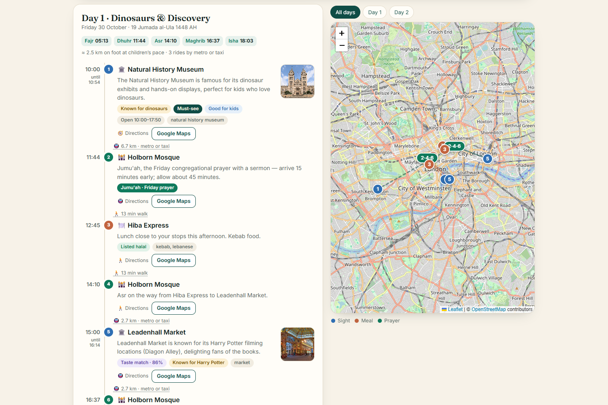
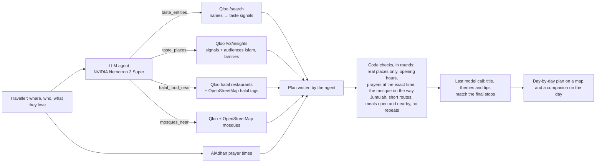

# Rihla — رحلة

**A travel agent that knows your taste and respects your faith.**

🌍 **Live demo:** https://rihla-agent.vercel.app · 🎬 **Video (1 min):** https://youtu.be/KpyL4OQyVLw · 📦 **Code:** https://github.com/me7ko-dev/rihla ·
[](https://github.com/me7ko-dev/rihla/actions/workflows/tests.yml)



Rihla plans city trips for Muslim travellers and families. Tell it where you are going, who is travelling and
what you love — films, books, authors, music, games, teams — and its agent builds a day-by-day plan:

- 🎯 **places that fit your taste**, with an honest reason: *"Because you love Orhan Pamuk"*, *"Known for dinosaurs"*
- 🍽️ **halal food with an honest confidence level** — *Listed halal*, *Likely halal* or *Ask* — and a clear
  *Serves alcohol* flag; bars, pubs and meyhanes are never suggested
- 🕌 **every day built around the prayers**: Dhuhr, Asr and Maghrib at the mosque nearest to where you are at that
  moment, with the day's real prayer times and Hijri date — and Jumu'ah at a well-known mosque on Fridays
- 👨‍👩‍👧 **family-aware**: *Good for kids* places, famous highlights mixed with personal finds, walking times at
  children's pace
- 📱 **a companion on the day**: open the plan on your phone during the trip and Rihla shows what is *now* and
  *next*, a countdown to the next prayer with the mosque nearest to you, and halal food, mosques and more places
  *around you* — taken from the places Qloo already found for your plan, so it costs no new requests and works on
  weak internet. Before the trip, **Preview** any day with a time slider.
- 🧭 **one tap to Google Maps or Apple Maps** for every stop and every walk; trips stay saved on your phone

Built for the [Qloo Agentic Hackathon](https://qloo.devpost.com/).

## Why

Most AI travel planners are culturally blind: they send a Muslim family to a pub for dinner and forget that the
day has five prayers. Rihla is the opposite — it understands both what you love and how you live.

## How Qloo powers it

Qloo is behind every kind of stop, not just one feature:

| What | Qloo API |
|---|---|
| Your favourites become taste signals ("Harry Potter" → the book, not the album) | `/search`, ranked by name match, type and Qloo popularity |
| Sights ranked by your taste **and** by Qloo audiences *Islam* and *Parents with young children* | `/v2/insights` with `signal.interests.entities` + `signal.demographics.audiences` |
| Honest "because you love X": each taste is asked on its own, and a place carries the badge only if that taste lifts it at least 5 places above the same query without any taste (the city's famous ten are never "because you love Frozen") | `/v2/insights`, one query per signal + one baseline |
| Topics you wrote ("dinosaurs", "calligraphy") become Qloo tags and rank places too; *Known for dinosaurs* only when Qloo tags the place with it, or reviewers' keywords are exactly your topic ("dinosaur fossils" yes, "street food" for a street-art lover no) | `/v2/tags` → `signal.interests.tags`, place keywords |
| Famous highlights next to personal finds | `/v2/insights` without signals |
| Halal restaurants ranked by your taste; "listed" (halal-restaurant category) vs "mentioned" (reviews) | `filter.tags=urn:tag:cuisine:qloo:halal`, place tags |
| No bars, pubs, nightclubs, meyhanes — excluded on Qloo's side | `filter.exclude.tags` |
| Mosques, photos, descriptions, *good for kids*, opening hours, what reviewers mention most ("dinosaurs" at the Natural History Museum) | place properties |
| Never a hotel, shop, office or a place closed for good as a "sight" (rooms, check-in times, `is_closed`) | place properties |

OpenStreetMap adds halal-tagged restaurants and more mosques; AlAdhan gives prayer times (calculation method per country).

## The agent



An LLM agent (NVIDIA Nemotron 3 Super, fallback Groq) researches with tools, then writes the itinerary:

1. `taste_entities` — turns everything you named into Qloo entities (only names you actually wrote; topics such as
   "dinosaurs" or "calligraphy" are matched against what places are known for)
2. `taste_places` — museums, landmarks, parks, family attractions… ranked by your taste
3. `halal_food_near`, `mosques_near` — for each day's area (Rihla fills any area the model forgot)
4. the plan — then code checks it, in rounds until nothing has to be left out: every stop must be a real place from
   the tools; a place you asked for or that matches what you love is never left out (moved to a day it is open);
   visits within opening hours; prayers at the exact time, at the mosque on the way between the stops around them
   (looked up there if none is known), Jumu'ah on Fridays; lunch just after Dhuhr, meals near where you are and open
   then, no repeats (not even another branch of a chain); time to walk or ride between stops — a visit ends in time
   to reach the mosque. The model cannot invent places.
5. a short last call to the model rewrites the title, summary, day themes and tips to match the final stops (and
   translates the code's texts in a plan in another language).

**Honest halal labels:** *Listed halal* only for a Qloo halal restaurant or `diet:halal=only` on OpenStreetMap;
`diet:halal=yes` (halal options) is *Likely*; any place that serves alcohol is at most *Likely* and shows *Serves
alcohol* — and in a plan it is swapped for a place without alcohol nearby when there is one. Texts never claim
"halal" or "alcohol-free": only the label speaks.

## Run locally

```bash
pip install -r requirements.txt
cp .env.example .env   # add QLOO_API_KEY, NVIDIA_API_KEY (and optionally GROQ_API_KEY)
uvicorn app.main:app --port 8090
```

Open http://localhost:8090. Qloo responses are cached for a week (the hackathon key allows 10,000 requests a month).

Tests (offline, no keys needed — 150 of them, from halal labels to Jumu'ah): `pip install pytest && pytest -q`

## On the day: the Today companion

A plan is only useful if it helps on the street. When the date of a saved trip comes, Rihla opens on *Today*:

- **Now and next** — the stop you are at, the next one with a countdown and directions
- **Next prayer** — "Dhuhr · 12:58 · in 40 min" and the mosque in your plan, or the one nearest to you once you
  share your location (asked only when you tap the button; it never leaves the phone)
- **Around you** — halal food (most certain first, *Serves alcohol* flagged), mosques and *More to see* (taste
  matches first, "Because you love …"), each with walking time and directions

All of it comes from the Qloo (and OpenStreetMap) results the agent gathered for the plan, sent with the plan as
`nearby` — so the companion makes **zero new Qloo requests** and keeps working on weak roaming internet. Judges and
travellers planning ahead can press **Preview Day 1 now** and drag the time slider through the day.

## Reliability
- If the language model is unavailable, Rihla runs the same tools itself and assembles the plan from the same Qloo
  results, so a visitor never sees an empty error.
- Every plan is ready within 4 minutes, well inside the server's limit: a slow model hands over to the next one, and
  when time runs short Rihla assembles the plan itself.
- If prayer times cannot be loaded, the plan is still made and says so; nothing is ever scheduled during a prayer.
- If OpenStreetMap's geocoder refuses the server, the destination is found with Qloo instead (only when the name matches).
- API keys stay on the server (never in the browser, never in error messages); a fair-use limit protects the
  monthly Qloo quota, and a plan that fails never counts against it.

## License

MIT — see [LICENSE](LICENSE).

Data: taste data © Qloo · map data © OpenStreetMap contributors (ODbL) · prayer times: aladhan.com
